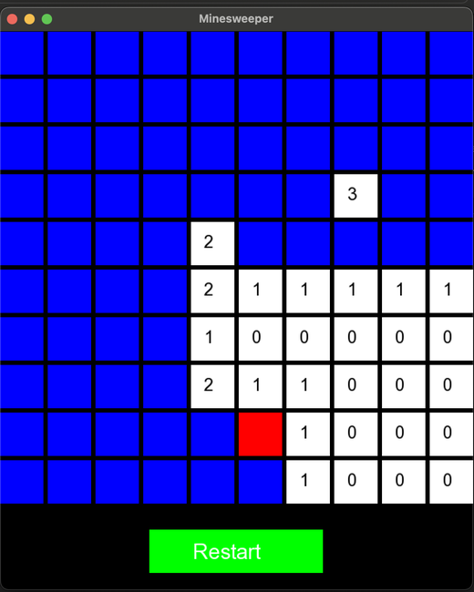
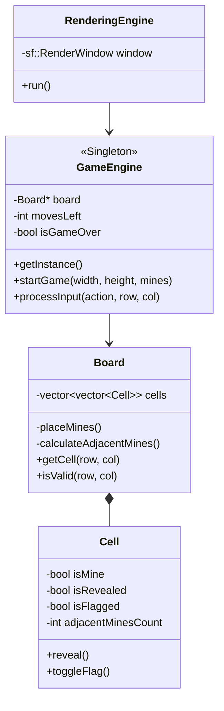

# Minesweeper

A desktop Minesweeper game written in C++ with [SFML](https://www.sfml-dev.org/). The game was designed with UML first and then built in layers: game logic as a standalone engine, with a separate graphical renderer on top.

<p align="center">
  
</p>

## Features

- 10×10 board with randomly placed mines
- Automatic opening of empty areas: revealing a cell with no adjacent mines opens all connected empty cells and their borders
- Flags to mark suspected mines; flagged cells are protected from accidental reveal
- Win and loss detection with an end-game screen
- Restart button to start a new game at any time

## Controls

| Action | Input |
| --- | --- |
| Reveal a cell | Left click |
| Place or remove a flag | Ctrl + left click |
| New game | Click **Restart** |

## Architecture

The code is split into four classes with clear responsibilities. Game rules know nothing about rendering, so the same engine could drive a console or a different graphical front end.



- **Cell** holds the state of one square: mine, revealed, flagged and the number of neighbouring mines.
- **Board** owns the grid, places mines and precomputes the neighbour count for every cell once, so the game never recalculates it during play.
- **GameEngine** is a Singleton that runs the rules: it processes reveal and flag actions, performs the recursive flood fill over empty cells and tracks the game state.
- **RenderingEngine** draws the board with SFML, translates mouse clicks into board coordinates and passes them to the engine.

Winning is checked with a counter of safe cells left to reveal. It decreases on every reveal, so the win check takes constant time instead of scanning the whole board after each move.

### Design documents

Before writing code, the system was modelled with five UML diagrams: class, sequence, state, activity and use case. They are in [docs/Game_Engine_Design.pdf](docs/Game_Engine_Design.pdf).

## Build and run

The game uses the **SFML 2** API (2.5 or 2.6). SFML 3 is not compatible.

**macOS (Homebrew)**

```bash
brew install sfml@2
g++ -std=c++17 main.cpp -o minesweeper \
  -I"$(brew --prefix sfml@2)/include" -L"$(brew --prefix sfml@2)/lib" \
  -lsfml-graphics -lsfml-window -lsfml-system
./minesweeper
```

**Ubuntu / Debian**

```bash
sudo apt install libsfml-dev
g++ -std=c++17 main.cpp -o minesweeper -lsfml-graphics -lsfml-window -lsfml-system
./minesweeper
```

Run the game from the project folder, because the font file is loaded from the working directory.

## Possible improvements

- Guarantee that the first click never hits a mine
- Difficulty levels with different board sizes and mine counts
- Timer and remaining-mine counter
- Iterative flood fill instead of recursion, for very large boards
- `std::unique_ptr` for the board instead of a raw pointer

## Tech stack

C++17 · SFML 2 · UML
